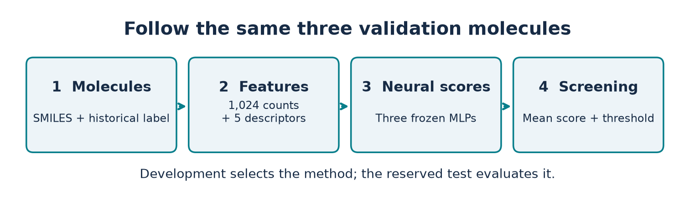

# Synthesis route screening on a CPU

A small neural ensemble predicts whether a historical AiZynthFinder search found a synthesis route for a molecule. It uses molecular structure to prioritize more expensive route searches. The score describes historical planning outcomes; a chemist still needs reaction routes, conditions and yields to assess a synthesis.

The repository includes training and analysis code, frozen checkpoints, saved evaluation outputs, a SMILES prediction command and a prebuilt LecTrace demonstration. The demonstration can run without installing machine-learning libraries.



## Start with the interactive demonstration

Download or clone this repository and open a terminal in its root directory. With Python 3 installed:

```sh
python scripts/serve_demo.py
```

The browser opens `http://127.0.0.1:8782/lectrace/#/?trace=01_route_found&step=1`. If the port is occupied, use `python scripts/serve_demo.py --port 8783`. Stop the local server with Ctrl+C.

Use the arrow keys to advance and **E** to inspect variables. Four computational states follow three validation molecules through structure parsing, feature encoding, neural activations and the final decision. Eight figures connect the code with its outputs and the study results. Viewing the prebuilt trace requires only the Python standard library.

## Install the model environment

Use Python 3.12. Create an environment in `work/.venv` from the repository root:

```sh
python -m venv work/.venv
```

Activate it in your terminal:

| Terminal | Command |
| --- | --- |
| Windows PowerShell | `./work/.venv/Scripts/Activate.ps1` |
| Windows Command Prompt | `work\.venv\Scripts\activate.bat` |
| macOS / Linux | `source work/.venv/bin/activate` |

Install the recorded experiment dependencies:

```sh
python -m pip install -r src/rascore/requirements-lock.txt --extra-index-url https://download.pytorch.org/whl/cpu
python -m pip check
```

The lock file records the original environment, including its CPU PyTorch build. Package availability can differ by platform. If an exact wheel is unavailable, record the replacement versions before interpreting numerical differences. The prebuilt demonstration and the standard-library verification command remain usable independently of the ML installation.

The experiment uses two CPU threads. A GPU is unnecessary. The full repeated experiments take substantially more time and memory than a single prediction.

## Predict from SMILES

With the ML environment active:

```sh
python scripts/predict.py --smiles "CCO" --smiles "CC(=O)Oc1ccccc1C(=O)O"
```

For a CSV with a `smiles` column:

```sh
python scripts/predict.py --input molecules.csv --output predictions.csv
```

Use `--column canonical_smiles` for a different column name. The output contains `route_found_score`, the frozen threshold and `prioritize` (1 when the score meets or exceeds the threshold). Invalid SMILES cause an explicit input error. The default threshold is **0.5844208399454752**, selected on validation data to favor fewer missed candidates. It belongs to the included count ensemble and scaler.

This command loads three frozen models on the CPU and averages their sigmoid outputs. It does not generate a synthesis route. The static website presents saved execution; changing a SMILES in this command is the way to obtain a new prediction.

## Verify the published results

This read-only command needs only Python's standard library:

```sh
python scripts/verify_release.py
```

It checks frozen model and preprocessing hashes, the recorded computational sources, the development sample, the locked evaluation plan, saved official-output hashes, ensemble means and all four threshold decisions/confusion matrices for 19,935 molecules. It prints `PASS` on success. It neither trains nor runs inference on the official test.

## Run development experiments

Create a separate experiment workspace so new training has its own outputs:

```sh
python scripts/create_training_workspace.py
cd work/training-run
```

Keep the ML environment active. A short pilot provides a first end-to-end training run:

```sh
python src/rascore/pilot.py --sample-size 2000 --epochs 5
```

The first audit downloads the public raw archive to this workspace's `work/rascore-data/data.zip` and verifies its SHA-256. It checks all raw structures before selecting the pilot sample, so the audit can take longer than the small training run.

For the full development sequence, run the following from `work/training-run`:

```sh
python src/rascore/experiment_20k.py
python src/rascore/verify_20k.py
python src/rascore/report_20k.py
python src/rascore/main_experiments.py
python src/rascore/report_main_experiments.py
python src/rascore/feature_ablation.py
python src/rascore/analyze_feature_ablation.py
python src/rascore/improvement_experiments.py
python src/rascore/analyze_improvements.py
```

The stages share the fixed 20,000-molecule sample. They compare network size and regularization, majority/logistic/random-forest baselines, repeated random/scaffold splits, descriptor ablations, count fingerprints and three-seed ensembles. Results go to that workspace's `src/rascore/results/` directory. Existing experiment guards prevent some completed runs from being overwritten; use a new workspace when changing a protocol.

`freeze_candidate.py` records the final development-selected candidate and comparator. `evaluate_holdout.py` and its plan are retained as the historical evaluation implementation. The included official test has already been evaluated; further method development needs newly reserved or external evaluation data.

## Rebuild the LecTrace demonstration

Return to the repository root with the ML environment active:

```sh
python -m pip install src/rascore/presentation/vendor/lectrace-1.1.30-py3-none-any.whl
python src/rascore/presentation/build_presentation.py
python scripts/sync_demo.py
python scripts/serve_demo.py
```

The build performs real inference on the first three saved validation rows and checks their means against saved predictions. It generates the molecular drawings and scientific figures, then uses the official LecTrace builder to create the trace. `sync_demo.py` copies that build to `docs/lectrace/` for static hosting. The included viewer was built with LecTrace 1.1.30.

## Deploy the public demonstration

Deploy the **`docs/` directory**. All viewer assets and trace data are prebuilt; the hosting service needs no Python, model weights or training job. This publishes the interactive presentation, while prediction for new molecules remains a local Python command.

### GitHub Pages

After pushing the repository, open **Settings → Pages → Build and deployment**. Choose **Deploy from a branch**, branch **main**, folder **/docs**, then save. Open the address shown by GitHub after its deployment finishes. The root page is a project landing page that links to the lecture at `lectrace/`. The published site is at <https://ashhspirt.github.io/synthesis-route-screening/>. See the [official GitHub Pages publishing guide](https://docs.github.com/en/pages/getting-started-with-github-pages/configuring-a-publishing-source-for-your-github-pages-site).

### Vercel

Import the GitHub repository. Use the repository root, framework preset **Other**, no build command and output directory **docs**. The included `vercel.json` supplies the static output setting. After deployment, open the assigned domain; its root opens the lecture. See [Vercel build configuration](https://vercel.com/docs/builds/configure-a-build).

`netlify.toml` also points Netlify at `docs/`. Any static HTTP host can serve the same folder. Rebuild and synchronize the demo before pushing later presentation edits.

## Method and saved result

Morgan count fingerprints (radius 2, 1,024 hashed positions) are transformed by `log1p` and combined with five descriptors scaled using training data only. Three MLPs use hidden widths **256 → 128 → 64**, ReLU and dropout 0.2. Validation loss selects the restored checkpoint. Predictions average seeds 42, 43 and 44.

The final development scaffold split contains 16,196 training and 3,804 validation molecules. The saved official comparison uses 19,935 molecules:

| Metric | Count ensemble | Matched binary ensemble |
| --- | ---: | ---: |
| AUROC | 0.8888 | 0.8852 |
| Recall-oriented false negatives | 1,464 | 1,624 |
| Recall-oriented false positives | 1,612 | 1,567 |

The paired AUROC gain is **0.00362**, with a saved 95% bootstrap interval of **0.00232–0.00495**. The count policy recalls **90.24%** of historical positives, trading 45 more false positives for 160 fewer false negatives relative to the matched binary policy. Ring-rich structures remain difficult: the false-negative rate is **26.51%** for molecules with more than four rings. These values come from the included saved evaluation artifacts.

## Repository map and data provenance

| Path | Contents |
| --- | --- |
| `scripts/` | Prediction, read-only verification, demo serving and workspace helpers |
| `src/rascore/*.py` | Original development, ablation, freezing and evaluation implementations |
| `src/rascore/results/frozen_candidate_v1/` | Six frozen checkpoints, scaler, partitions, thresholds and histories |
| `src/rascore/results/official_holdout_v1/` | Saved predictions, metrics, uncertainty and subgroup outputs |
| `src/rascore/results/experiment_20000_three_seeds/data/` | The fixed public development sample and binary feature cache |
| `src/rascore/report/` | Machine-readable historical evaluation plan and one comparison figure |
| `src/rascore/presentation/` | Public lecture source, model demo, figure generator and LecTrace attribution |
| `docs/` | Ready-to-host static demonstration |
| `work/` | Ignored environments, raw downloads and new experiment workspaces |

The two-level `src/rascore` layout preserves the original computational source hashes and relative data-path behavior. Raw labels and structures come from the [pinned RAscore repository](https://github.com/reymond-group/RAscore/tree/cb77db503ee5cbf0e8bb8963df6e5b76b3a94f06), commit `cb77db503ee5cbf0e8bb8963df6e5b76b3a94f06`. The raw `data/data.zip` checksum is `f73b3028592ff95feeeb2f4e0285005d956976c810a3818fc399c20480979ef3`.

The frozen manifest retains its historical `frozen_not_tested` state. The later `official_holdout_v1/execution.json` records completion. See [third-party notices](THIRD_PARTY_NOTICES.md) for data and software attribution.
